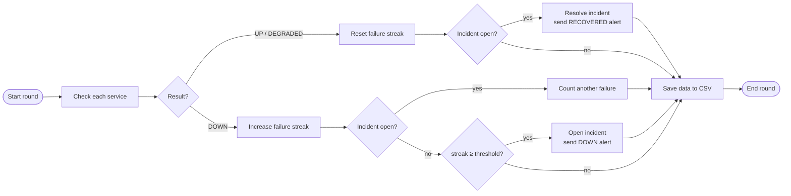
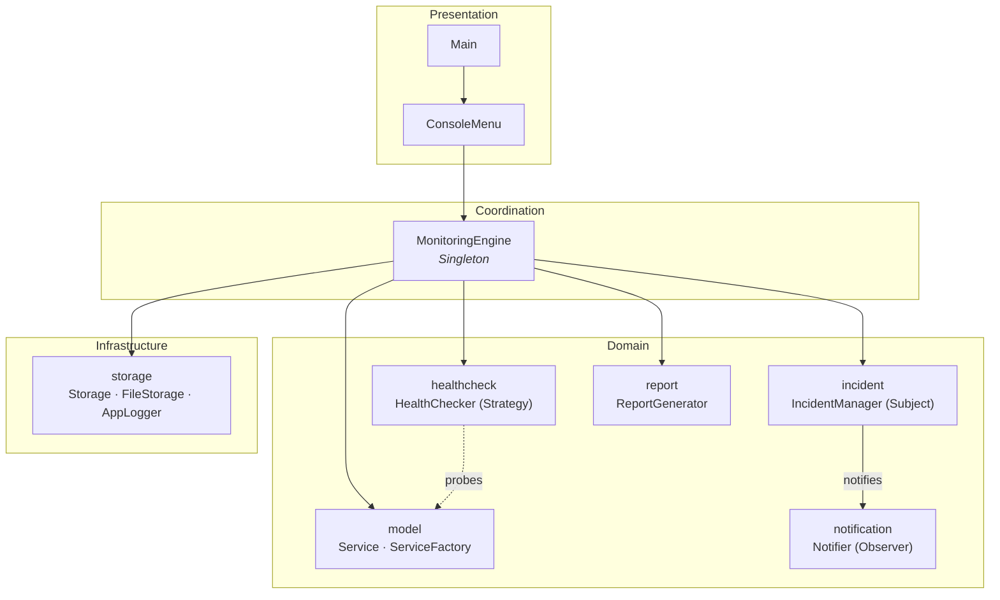
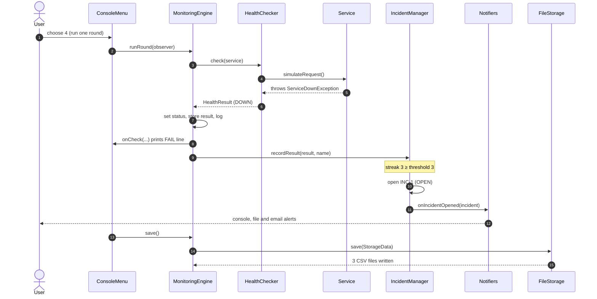
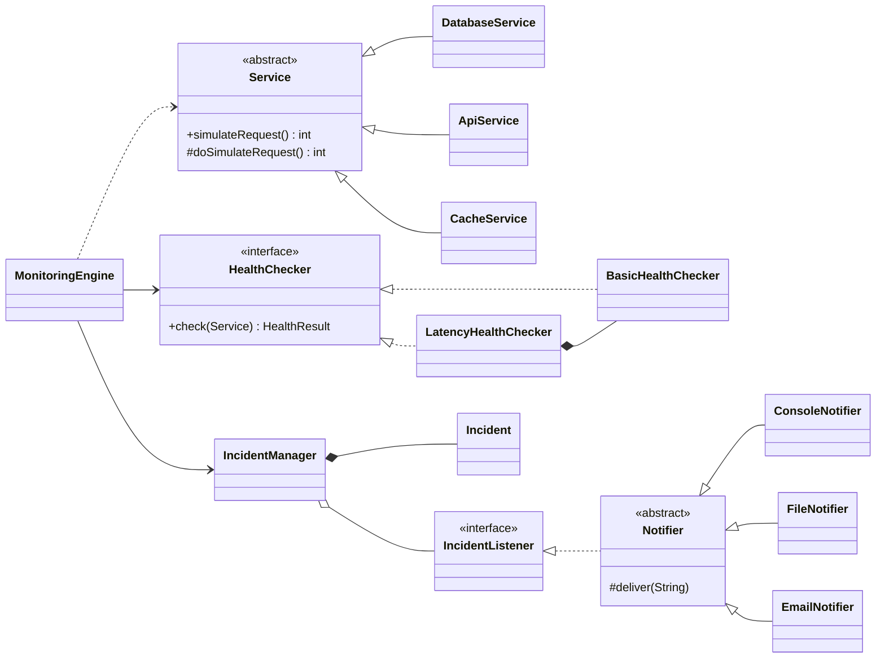
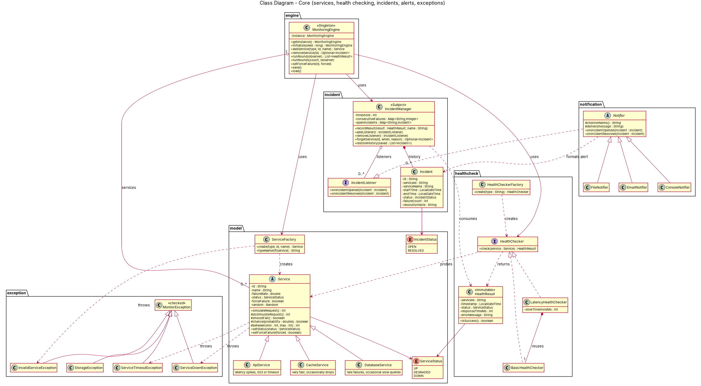

<div align="center">

```
 ╔═══════════════════════════════════════════════════════╗
 ║   ◉  U P T I M E   ·   H E A L T H   ·   I N C I D E N T S   ◉   ║
 ╚═══════════════════════════════════════════════════════╝
```

# 🛰️ OOP Uptime

### Service Health Monitoring & Incident Management System

*A console-based Java application that watches simulated services, detects real outages,
raises incidents, fires alerts and tells you exactly how reliable everything was.*

<br>


[**Quick Start**](#-quick-start) ·
[**Demo**](#-two-minute-demo) ·
[**Architecture**](#-architecture) ·
[**Design Patterns**](#-design-patterns) ·
[**UML**](#-uml-diagrams) ·
[**Testing**](#-testing)

</div>

---

## 📖 Table of Contents

1. [Overview](#-overview)
2. [Features](#-features)
3. [Quick Start](#-quick-start)
4. [Using the Application](#-using-the-application)
5. [Two-Minute Demo](#-two-minute-demo)
6. [How It Works](#-how-it-works)
7. [Architecture](#-architecture)
8. [Project Structure](#-project-structure)
9. [Module Reference](#-module-reference)
10. [Design Patterns](#-design-patterns)
11. [UML Diagrams](#-uml-diagrams)
12. [Data & Persistence](#-data--persistence)
13. [Error Handling](#-error-handling)
14. [Testing](#-testing)
15. [Troubleshooting](#-troubleshooting)
16. [Documentation](#-documentation)
17. [Roadmap](#-roadmap)
18. [Author](#-author)

---

## 🌟 Overview

Real monitoring tools answer one question: **"Is my service actually broken, or was that just a blip?"**

`OOP Uptime` models that problem end to end. Three kinds of simulated services (a **database**, an **API** and a **cache**) misbehave on purpose, each in its own way. The system checks them in rounds, decides when a service is *truly* down (N failures in a row, default **3**), opens an **incident**, alerts through **three channels**, saves its history to disk, and produces **uptime and response-time reports**.

The project is built to showcase **object-oriented design**: independent modules, interfaces, inheritance, polymorphism, classic design patterns, custom exceptions, collections and full UML documentation.

> **In one sentence:** a small, clean, thoroughly tested Java system where every class has one job and every module can be swapped without touching the rest.

---

## ✨ Features

| | Feature | Details |
|---|---|---|
| 🧪 | **Simulated services** | `DatabaseService`, `ApiService`, `CacheService`, each with its own latency profile and failure style |
| 🩺 | **Smart health checks** | Failures are classified as `UP`, `DEGRADED` (slower than 400 ms) or `DOWN` |
| 🚨 | **Incident management** | Opens after N consecutive failures, counts further failures, auto-resolves on recovery |
| 📣 | **Three alert channels** | Console, log file (`alerts.log`) and simulated email, isolated so one failure never blocks the others |
| 📊 | **Reports & rankings** | Uptime %, average and slowest response, recent-window uptime, ranked by uptime, speed or name |
| 💾 | **Safe persistence** | CSV storage with atomic writes and line-accurate error messages on corrupt files |
| 🎛️ | **Demo mode** | `--seed` gives reproducible randomness; a "force failure" switch makes outages on demand |
| 🧱 | **Zero runtime dependencies** | Plain Java 17. JUnit is used for tests only |

---

## 🚀 Quick Start

### Prerequisites

| Tool | Version | Check with |
|---|---|---|
| JDK | 17 or newer | `java -version` and `javac -version` |
| Maven | 3.8+ *(optional, for tests)* | `mvn -version` |

### 1. Clone

```bash
git clone https://github.com/jeevithrao/OOP_uptime.git
cd OOP_uptime
```

### 2. Build and run

<table>
<tr><th>🐧 Linux / 🍎 macOS</th><th>🪟 Windows (PowerShell)</th></tr>
<tr><td>

```bash
mkdir out
javac --release 17 -d out \
  $(find src/main/java -name "*.java")
java -cp out Main
```

</td><td>

```powershell
mkdir out
javac --release 17 -d out `
  (Get-ChildItem -Recurse src/main/java -Filter *.java).FullName
java -cp out Main
```

</td></tr>
</table>

### 3. Demo mode (recommended for your first run)

```bash
java -cp out Main --seed 42
```

Demo mode gives you **reproducible randomness** and a **clean start**. It stores its data in a separate `data-demo/` folder, so it never touches your real saved data.

---

## 🎮 Using the Application

When it starts you will see the main menu:

```text
===== Service Health Monitor =====
1. Add service
2. Remove service
3. List services and status
4. Run one check round
5. Run monitoring (N rounds)
6. View incidents
7. View reports
8. Configure failure threshold
9. Force a service to fail (demo mode)
0. Exit
```

| Option | What it does |
|:---:|---|
| **1** | Add a service. Choose a type (`database` / `db`, `api`, `cache`), an id and a display name |
| **2** | Remove a service. Any open incident for it is closed with a note |
| **3** | List every service with its current status (`[FORCED DOWN]` is shown when forced) |
| **4** | Run a single check round across all services |
| **5** | Run N rounds in a row (a safety cap applies) |
| **6** | Show open incidents and the full history |
| **7** | Show reports. Rank by uptime, average response time or name |
| **8** | View or change the failure threshold (default **3** consecutive failures) |
| **9** | Toggle "force failure" on a service so you can trigger an outage on demand |
| **0** | Save and exit |

> 💡 Anything that changes data (add, remove, check rounds) is **saved automatically**.
> Press **Ctrl+D** (end of input) and the program exits cleanly too.

---

## ⏱️ Two-Minute Demo

Run `java -cp out Main --seed 42`, then follow along:

| Step | Input | What you will see |
|:---:|---|---|
| 1 | **1** → `api` / `api-1` / `Payments API` | A new API service is added. Add a `cache` and a `database` as well |
| 2 | **9** → `api-1` | `api-1` is now forced to fail |
| 3 | **5** → `4` | Four rounds run. On the **3rd consecutive failure** an incident opens and **three alerts fire** |
| 4 | **6** | One open incident (`INC-1`) |
| 5 | **9** → `api-1`, then **4** | The service recovers. The incident resolves and a **RECOVERED** alert is sent |
| 6 | **7** | Uptime, response times and a ranking per service |
| 7 | **0**, then start again | Your services and incident history are back |

---

## ⚙️ How It Works



### The rules in plain English

- **One bad check is not an outage.** An incident only opens after *N consecutive failures* (default 3).
- **One good check ends the streak.** The counter resets, and any open incident is resolved.
- **Slow is not dead.** A successful response slower than **400 ms** is `DEGRADED`, which counts as healthy for incident purposes. A response of exactly 400 ms is still `UP`.
- **Alerts never block monitoring.** If one channel breaks, the others still deliver.

### Simulated service behaviour

| Service | Failure rate | Normal latency | Slow case | How it fails |
|---|:---:|:---:|:---:|---|
| 🗄️ `DatabaseService` | 3% | 20–60 ms | 10% of requests: 300–800 ms | Connection refused |
| 🌐 `ApiService` | 15% | 50–200 ms | 20% of requests: 500–1500 ms | Timeout *or* HTTP 503 |
| ⚡ `CacheService` | 5% | 1–5 ms | none | Cache node dropped |

---

## 🏛️ Architecture

The engine is the **only** module that knows about the others. Everything else talks through interfaces.



### Request lifecycle



---

## 📁 Project Structure

```text
OOP_uptime/
├── pom.xml                          # Maven build (Java 17, JUnit 5)
├── README.md
├── docs/
│   ├── PROJECT_GUIDE.md             # full explanation of every module
│   ├── DECISIONS.md                 # decision log, phase by phase
│   └── uml/                         # PlantUML sources + PNG/SVG exports
└── src/
    ├── main/java/
    │   ├── Main.java                # entry point, --seed support
    │   ├── model/                   # Service hierarchy, factory, enums
    │   ├── healthcheck/             # HealthChecker strategies, HealthResult
    │   ├── incident/                # Incident, IncidentManager, listener
    │   ├── notification/            # Console / File / Email notifiers
    │   ├── report/                  # ReportGenerator, ServiceReport
    │   ├── storage/                 # Storage, FileStorage, Csv, AppLogger
    │   ├── exception/               # custom checked exceptions
    │   ├── engine/                  # MonitoringEngine (Singleton)
    │   └── console/                 # ConsoleMenu (input/output only)
    └── test/java/                   # 154 JUnit 5 tests
```

---

## 🧩 Module Reference

<details>
<summary><b>🗄️ model</b>: the services themselves</summary>

<br>

- **`Service`** (abstract) holds `id`, `name`, a validated `failureRate` (0 to 1), `status`, a `forceFailure` switch and an injected `Random`.
- `simulateRequest()` is a **final Template Method**: it handles the force-fail switch, then delegates to the abstract `doSimulateRequest()`.
- **`DatabaseService`, `ApiService`, `CacheService`** each implement `doSimulateRequest()` with their own latency and failure style (see the table above).
- **`ServiceFactory`** creates a service from a type name. Each service receives its own `Random`, seeded from one master, so a seeded session is fully reproducible.
- **`ServiceStatus`** is `UP`, `DEGRADED` or `DOWN`. **`IncidentStatus`** is `OPEN` or `RESOLVED`.

</details>

<details>
<summary><b>🩺 healthcheck</b>: probing and judging</summary>

<br>

- **`HealthChecker`** is the Strategy interface: `check(Service) → HealthResult`. Service failures are *returned* as `DOWN`, never thrown.
- **`BasicHealthChecker`** treats any successful call as `UP` and any service exception as `DOWN`.
- **`LatencyHealthChecker`** wraps the basic checker and marks responses **slower than 400 ms** as `DEGRADED`.
- **`HealthCheckerFactory`** builds a checker from `"basic"` or `"latency"`.
- **`HealthResult`** is immutable. Success is derived from the status, so contradictory states cannot exist.

</details>

<details>
<summary><b>🚨 incident</b>: streaks, incidents and the Observer subject</summary>

<br>

- **`Incident`** records one outage: id (`INC-n`), service, start and end time, failure count and status. It stores the service id and name as text so it stays valid after the service is removed.
- **`IncidentManager`** owns the rule: reset the streak on success, count failures, open at the threshold, resolve on recovery. It then notifies every registered `IncidentListener`.
- Listeners are isolated: one that throws never stops the others.
- Saved history can be restored, and open incidents become active again.

</details>

<details>
<summary><b>📣 notification</b>: alert channels</summary>

<br>

- **`Notifier`** (abstract, implements `IncidentListener`) builds the alert text once and calls the abstract `deliver()` (Template Method).
- **`ConsoleNotifier`** prints to a `PrintStream`.
- **`FileNotifier`** appends timestamped lines to `data/alerts.log`.
- **`EmailNotifier`** simulates sending an email to a recipient.

</details>

<details>
<summary><b>📊 report</b>: statistics and rankings</summary>

<br>

- **`ReportGenerator`** computes uptime % (successful ÷ total checks), average and slowest response (successful checks only) and uptime over the **last 10 checks**.
- Rankings can be ordered by uptime, response time or name. Services with no data always sort last.
- **`ServiceReport`** is a record using `Optional`, so "0% uptime" is never confused with "no data".

</details>

<details>
<summary><b>💾 storage</b>: persistence and logging</summary>

<br>

- **`Storage`** is the interface (`save`, `load`), so the engine knows nothing about CSV.
- **`FileStorage`** writes `services.csv`, `results.csv` and `incidents.csv` through a temp file that is then moved over the real one (**atomic writes**).
- **`Csv`** is a small quote-aware reader and writer, so names like `Payments, EU` survive a round trip.
- **`AppLogger`** (Singleton) writes `data/monitor.log` and never throws.

</details>

<details>
<summary><b>🧠 engine and 🖥️ console</b>: coordination and UI</summary>

<br>

- **`MonitoringEngine`** (Singleton) wires everything together and runs a round: check, set status, store, log, display, then record the incident logic. It contains **no rules** of its own.
- Its constructor takes every collaborator, so tests can inject fakes while the Singleton remains the normal entry point.
- **`ConsoleMenu`** only reads input and prints output. Its streams are injectable, so tests can script complete sessions.

</details>

---

## 🎨 Design Patterns

| Pattern | Where | Why it is there |
|---|---|---|
| **Singleton** | `MonitoringEngine`, `AppLogger` | One coordinator and one log for the whole app |
| **Factory** | `ServiceFactory`, `HealthCheckerFactory` | Create the right object from a type name |
| **Strategy** | `HealthChecker` → `BasicHealthChecker`, `LatencyHealthChecker` | Swap checking logic without touching the engine |
| **Observer** | `IncidentManager` → `IncidentListener` / `Notifier` | Alerts react to incidents without coupling |
| **Template Method** | `Service.simulateRequest()`, `Notifier.onIncident…()` | Fixed skeleton in the base class, variable step in subclasses |

### OOP principles at a glance

| Principle | Example in this project |
|---|---|
| **Abstraction** | `Service`, `HealthChecker`, `Storage` and `IncidentListener` hide their implementations |
| **Encapsulation** | Private state with validation. `Incident` can only be changed by `IncidentManager` |
| **Inheritance** | `Service` → 3 concrete services. `Notifier` → 3 channels. `MonitorException` → 4 subtypes |
| **Polymorphism** | The engine calls `simulateRequest()` and `check()` without knowing the concrete type |
| **Composition** | `LatencyHealthChecker` *has a* `BasicHealthChecker` |

### Class relationships



---

## 📐 UML Diagrams

Full-resolution diagrams live in [`docs/uml/`](docs/uml/) as PlantUML source plus PNG and SVG exports.

| Diagram | Preview | Source |
|---|:---:|---|
| **Use case** | [PNG](docs/uml/use-case.png) · [SVG](docs/uml/use-case.svg) | [`use-case.puml`](docs/uml/use-case.puml) |
| **Class (core)**: services, checking, incidents, alerts, exceptions | [PNG](docs/uml/class-diagram.png) · [SVG](docs/uml/class-diagram.svg) | [`class-diagram.puml`](docs/uml/class-diagram.puml) |
| **Class (supporting)**: engine, console, reports, storage | [PNG](docs/uml/class-diagram-supporting.png) · [SVG](docs/uml/class-diagram-supporting.svg) | [`class-diagram-supporting.puml`](docs/uml/class-diagram-supporting.puml) |
| **Sequence**: a check that fails for the third time | [PNG](docs/uml/sequence-third-failure.png) · [SVG](docs/uml/sequence-third-failure.svg) | [`sequence-third-failure.puml`](docs/uml/sequence-third-failure.puml) |
| **Activity**: the check cycle | [PNG](docs/uml/activity-check-cycle.png) · [SVG](docs/uml/activity-check-cycle.svg) | [`activity-check-cycle.puml`](docs/uml/activity-check-cycle.puml) |

<p align="center">
  
</p>

Regenerate the images after editing a diagram:

```bash
plantuml -tpng docs/uml/*.puml
```

---

## 💾 Data & Persistence

Everything is saved automatically after every change and on exit, as CSV files in `data/`.

| File | Contents |
|---|---|
| `data/services.csv` | Configured services (type, id, name, failure rate) |
| `data/results.csv` | Every health-check result |
| `data/incidents.csv` | Full incident history, including open incidents |
| `data/monitor.log` | Everything the system did |
| `data/alerts.log` | Every alert that was sent |

- Files are loaded at startup, so an incident that was **open when you quit is still open**, and it resolves when the service recovers.
- **Not saved on purpose:** demo force-failure switches, the failure threshold and round numbers.
- Demo mode (`--seed`) uses `data-demo/` instead of `data/`.

---

## 🛡️ Error Handling

| Situation | Behaviour |
|---|---|
| Corrupt data file at startup | The program refuses to start and names the **file and line**. Nothing is overwritten |
| Save fails mid-session | A warning is printed and the menu keeps running |
| A notifier throws | It is isolated; the other channels still deliver |
| Logging fails | One warning on stderr, then silent. Logging never crashes the app |
| Invalid input (bad id, type, threshold, rate) | A clear message and the menu continues |
| Crash during a save | Atomic writes mean a half-written file is never left behind |

Custom checked exceptions, all rooted at `MonitorException`: `ServiceDownException`, `ServiceTimeoutException`, `InvalidServiceException`, `StorageException`.

---

## 🧪 Testing

The project ships with **154 JUnit 5 tests** in `src/test/java`.

```bash
mvn test
```

| Area | What is verified |
|---|---|
| **Incident rules** | Exact threshold, streak reset, listener isolation |
| **Health checkers** | The 400 ms boundary, `DOWN` pass-through |
| **Reports** | Uptime math, "no data" handling, ranking order |
| **Storage** | CSV round trips, corrupt files, atomic writes |
| **Engine** | Rounds, add and remove, save and load |
| **Console** | Whole scripted menu sessions with injected input and output |

---

## 🔧 Troubleshooting

| Problem | Fix |
|---|---|
| `javac: command not found` | Install a JDK (not just a JRE) and make sure it is on your `PATH` |
| `invalid target release: 17` | Your JDK is older than 17. Install JDK 17 or newer |
| `Could not find or load main class Main` | Run `java -cp out Main` from the project root, after compiling into `out` |
| `find` does not work on Windows | Use the PowerShell commands in [Quick Start](#-quick-start) |
| "Corrupt data file" at startup | Open the file named in the message and fix the line, or delete the file to start fresh |
| Want a totally clean slate | Delete the `data/` folder (or `data-demo/` for demo mode) |
| Results differ between runs | Normal. Use `--seed 42` for reproducible randomness |

---

## 📚 Documentation

| Document | What is inside |
|---|---|
| [`docs/PROJECT_GUIDE.md`](docs/PROJECT_GUIDE.md) | The full explanation of every module, the decisions behind them and viva questions |
| [`docs/DECISIONS.md`](docs/DECISIONS.md) | The decision log, phase by phase |
| [`docs/uml/`](docs/uml/) | All UML sources and exports |

---

## 🗺️ Roadmap

- [x] Phase 0: project skeleton
- [x] Phase 1: foundation (enums, exceptions, service hierarchy)
- [x] Phase 2: health checking
- [x] Phase 3: incidents and alerts
- [x] Phase 4: engine and console menu
- [x] Phase 5: reports and storage
- [x] Phase 6: UML and documentation

**Ideas for the future**

- [ ] Real HTTP and TCP health checks behind the same `HealthChecker` interface
- [ ] Real email or Slack notifiers as new `Notifier` subclasses
- [ ] Scheduled background monitoring instead of manual rounds
- [ ] A web dashboard or REST layer on top of `MonitoringEngine`

---

## 👤 Author

**Jeevith Rao**
GitHub: [@jeevithrao](https://github.com/jeevithrao)

<div align="center">

<br>

*If this project helped you, consider leaving a ⭐ on the repository.*

</div>
